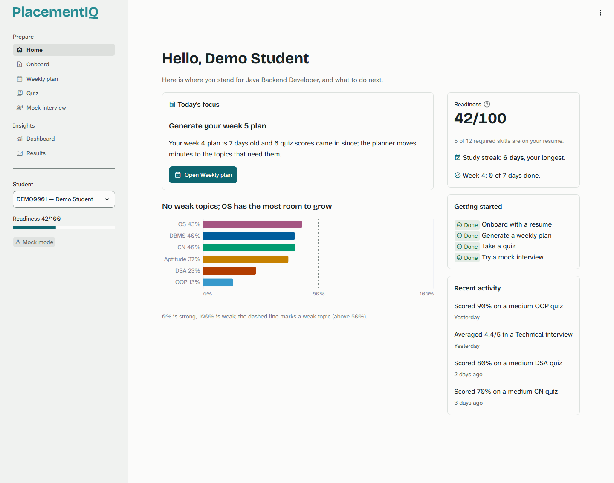
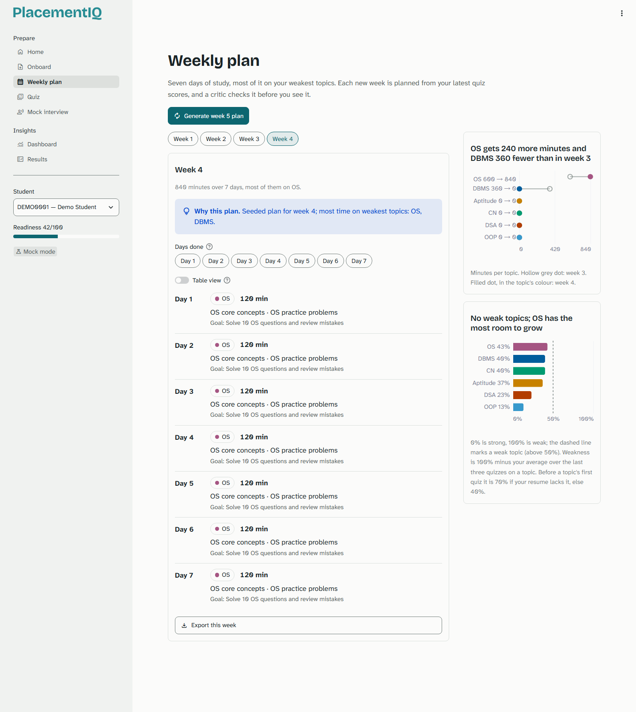
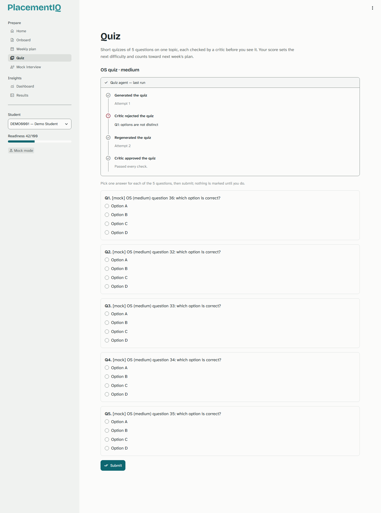
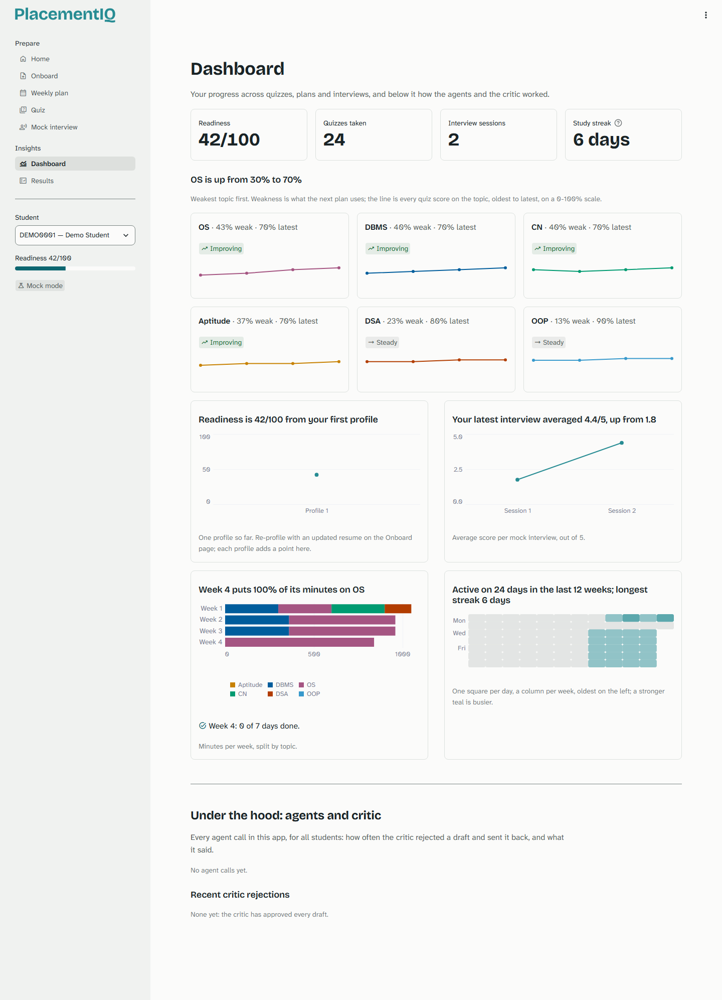

# PlacementIQ

An adaptive multi-agent placement-readiness coach. It profiles a resume against a target role, writes a weekly study plan, sets adaptive quizzes and runs mock interviews. A critic agent checks every generated output and forces a regeneration when the output fails. Quiz scores feed back into the next week's plan.

## Quick start (offline, no API key)
```
python -m venv .venv
.venv\Scripts\activate            # macOS/Linux: source .venv/bin/activate
pip install -r requirements.txt
python -m scripts.seed            # demo student DEMO0001 with 4 weeks of history
streamlit run app.py
```
Without a `.env` file the app runs in **MOCK_MODE**: canned responses and no network.

## Live mode (Groq free tier)
1. Copy `.env.example` to `.env` and set `GROQ_API_KEY`.
2. Set `MOCK_MODE=false`. The model IDs are already filled in (`openai/gpt-oss-120b` and `openai/gpt-oss-20b`, verified 2026-10-19).
3. Before a demo, run `python -m scripts.check_models`. It confirms both models are still served, that JSON mode works, and how much quota is left (each model allows 8,000 tokens/minute, 1,000 requests/day and about 200,000 tokens/day).

## Deploy (optional): Streamlit Community Cloud
1. On share.streamlit.io choose **Create app**, pick this repository (a private repo needs GitHub access granted to Streamlit), branch `main`, main file `app.py`, and Python 3.13 under **Advanced settings**.
2. Under **Secrets**, add:
   ```toml
   GROQ_API_KEY = "your key"
   GROQ_MODEL_LARGE = "openai/gpt-oss-120b"
   GROQ_MODEL_SMALL = "openai/gpt-oss-20b"
   MOCK_MODE = "false"
   SEED_DEMO = "true"
   ```
   Streamlit exposes top-level secrets as environment variables, so no code change is needed.
3. The hosted disk is not persistent: the SQLite file resets when the app restarts. With `SEED_DEMO=true` the demo student is recreated on start, so the demo always opens with history.

## Share a live demo (optional): Cloudflare quick tunnel
On Windows with [cloudflared](https://github.com/cloudflare/cloudflared/releases) installed,
double-click `scripts\tunnel.bat` (or run `powershell -ExecutionPolicy Bypass -File scripts\tunnel.ps1`).
It starts Streamlit if nothing is running on port 8501 and prints a temporary public
`https://…trycloudflare.com` URL for a phone or another laptop. There is no login: anyone
with the URL can use the app and, in live mode, spend the Groq quota, so close the window
when the demo ends.

## Features
- **Home**: what PlacementIQ does, or for a returning student their readiness, study
  streak, this week's progress and **today's focus**, the next step chosen by rules.
- **Onboard**: a resume (PDF, DOCX, TXT or a sample) against a target role gives a readiness
  score, the skills on the resume and missing for the role, and fixes. A USN that already
  belongs to someone asks before replacing them; a student can be deleted after typing
  their USN.
- **Weekly plan**: seven days of study weighted to the weakest topics, why the planner chose
  it, how the minutes moved since last week, days to tick off, and export as a calendar
  file (.ics) or a CSV.
- **Quiz**: topics ranked by weakness with a suggested difficulty, five questions checked
  by a critic (the step-by-step trail shows every rejection), a warning before submitting
  blanks, and a review with each answer marked, downloadable as notes.
- **Mock interview**: HR, technical or project interviews with follow-ups on vague
  answers, scored feedback per answer, a session summary with tips, and notes to keep.
- **Dashboard**: readiness over time, study streak and a 12-week activity calendar, topic
  mastery (weakness and trend per topic), plan minutes and interview scores, and, kept
  apart, how the agents and the critic behaved.
- **Results**: the evaluation against a single-prompt baseline, each metric defined.
- Light and dark themes, readable on a phone and on a projector; works offline in
  MOCK_MODE.

| Home | Weekly plan |
|---|---|
|  |  |
| **Quiz: the critic rejects a question and it is rewritten** | **Dashboard** |
|  |  |

## Demo path
1. **Home:** with no student selected, the four-step loop. Choose **Try it with a sample
   resume**.
2. **Onboard:** pick a USN and **Analyse resume**. The trail shows the profile agent and the
   critic; the profile shows readiness, matched and missing skills and resume fixes.
3. **Weekly plan:** **Generate week 1 plan**. Weak topics get the most minutes, and **Why
   this plan** says so. Tick a day done; export the week to a calendar.
4. **Quiz:** the weakest topic is preselected with a suggested difficulty. **Generate
   quiz**: in mock mode the critic rejects the first draft (duplicate options) and only that
   question is rewritten, step by step in the trail. Score low on purpose.
5. **Weekly plan:** generate the next week. The weakest topic gets more minutes, and the
   chart beside the plan states the shift.
6. **Mock interview:** give a vague answer and get a follow-up that quotes it, then scored
   feedback; finish the session for the summary.
7. **Dashboard:** switch to **DEMO0001** in the sidebar for four weeks of history: topic
   mastery, streak, plan minutes, interviews and, under the hood, the critic's rejections.
8. **Results:** baseline against PlacementIQ, each metric in plain words.

## Tests and evaluation
```
pip install -r requirements-dev.txt
pytest                                   # offline, includes headless UI tests (CI runs it on pushes to main and on pull requests)
python -m evaluation.run_eval --consecutive 5 --interviews   # live, 20 frozen cases; needs 2 days of free quota
python -m evaluation.run_eval --consecutive 5 --interviews --resume   # continue the next day
python -m evaluation.report              # results/report.md + chart.svg for the report
```

## Visual QA and performance (dev tools)
```
python -m playwright install chromium    # once
python -m scripts.screenshots docs/design/after             # every page and flow, 1440/1366/390 px, light and dark
python -m scripts.screenshots docs/design/after --pages quiz --widths 1440,390
python -m scripts.perf docs/design/perf.md                  # render time and queries per page (AppTest)
python -m scripts.perf docs/design/perf.md --mode rerun     # each page's own render cost
```
Both run in an isolated environment (MOCK_MODE, a temporary seeded database, `.env`
ignored) and never call Groq. The screenshot run fails on any browser console error; the
design system and the review loop are in [docs/design/DESIGN.md](docs/design/DESIGN.md),
and the before/after numbers in [docs/performance.md](docs/performance.md).

## Documentation
- [ARCHITECTURE.md](ARCHITECTURE.md): design, data flow, decisions, limitations
- [CLAUDE.md](CLAUDE.md): code map, commands and conventions
- [docs/diagrams.md](docs/diagrams.md): use case, components, DFD level 0/1, ER and sequence diagrams
- [docs/critic_graph.md](docs/critic_graph.md): the LangGraph critic loop, generated from the code
- [docs/test_report.md](docs/test_report.md): every test case and its result (`python -m scripts.test_report`)
- [docs/design/DESIGN.md](docs/design/DESIGN.md): the design system: tokens, type, components, charts
- [docs/performance.md](docs/performance.md): render time per page before and after the redesign
