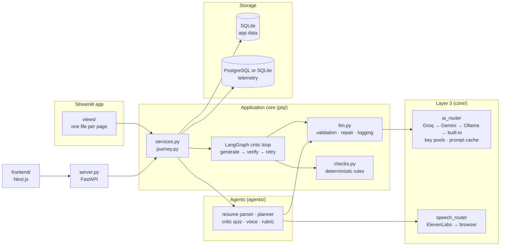

<div align="center">

<a href="https://github.com/prajwalparish-git/Skill-Scout-Nexus">
  <picture>
    <source media="(prefers-color-scheme: dark)" srcset="docs/assets/hero-dark.svg">
    
  </picture>
</a>

<p>
  <a href="https://github.com/prajwalparish-git/Skill-Scout-Nexus/actions/workflows/ci.yml"></a>
  
  
  
  
</p>

<p>
  <b>Profile a resume, close the skill gaps, practise under a critic's eye, and show the placement cell where the cohort stands.</b><br>
  Engineering, Commerce, Law, Management, Healthcare and Government roles, one app.
</p>

<p>
  <a href="#get-started-in-two-steps">Get started</a> ·
  <a href="#the-six-step-journey">The journey</a> ·
  <a href="#self-healing-by-design">Self-healing</a> ·
  <a href="#architecture">Architecture</a> ·
  <a href="#configuration">Configuration</a> ·
  <a href="#documentation">Docs</a>
</p>

</div>

---

## Get started in two steps

> You need Git and any Python from 3.8 upward to run the setup script. It brings the rest,
> including Python 3.13 itself if this machine does not have it, into this folder only.

**1. Get the code and set it up**

```bash
git clone https://github.com/prajwalparish-git/Skill-Scout-Nexus.git
cd Skill-Scout-Nexus
python bootstrap.py        # Windows: py bootstrap.py  ·  macOS / Linux: python3 bootstrap.py
```

Already have it? `git pull`, then run `python bootstrap.py` again: it only adds what is missing.

**2. Fill in `.env`, then start**

The setup prints which keys are still empty. With none filled in, the app runs in **mock
mode** (built-in answers, no network), which is enough to try every page.

| | Start the app | Then open |
|---|---|---|
| **Windows** | `.\run.ps1` | http://localhost:8501 |
| **macOS / Linux** | `./run.sh` | http://localhost:8501 |

<details>
<summary><b>What <code>bootstrap.py</code> does, and the other launcher commands</b></summary>

<br>

| Step | What happens | Where |
|---|---|---|
| 1 | Finds Python 3.13. If there is none, downloads [uv](https://github.com/astral-sh/uv) (pinned, checksum-verified) and installs a private Python 3.13 | `.tools/` |
| 2 | Creates a virtual environment | `.venv/` |
| 3 | Installs every dependency from `requirements.txt` | `.venv/` |
| 4 | Creates `.env` from `.env.example` (an existing `.env` is never touched) | `.env` |
| 5 | Writes the launcher for this system | `run.ps1` or `run.sh` |

Nothing is installed system-wide, and everything it makes is git-ignored. Options:
`--dev` (also pytest, ruff, Playwright), `--frontend` (also the Next.js packages; needs
Node.js 20+), `--local-python` (always use the private Python).

| Command | Does |
|---|---|
| `run app` (default) | The Streamlit app on port 8501 |
| `run seed` | A demo student with four weeks of history, and a demo cohort for the faculty dashboard |
| `run api` | The FastAPI server for the Next.js front end, on port 8000 |
| `run test` | The test suite (after `bootstrap.py --dev`) |
| `run check` | Checks the configured Groq models are served, JSON-capable and within quota |

On Windows, if PowerShell blocks scripts: `powershell -ExecutionPolicy Bypass -File .\run.ps1`.

</details>

---

## The six-step journey

| Step | Page | What the student gets |
|:---:|---|---|
| **1** | Onboarding and profile | A resume (PDF, DOCX, TXT or a sample) against a target role: readiness score, skills found and missing, resume fixes. A critic checks the profile. |
| **2** | Resume scan and skill gaps | The resume read against any catalog role in any stream: required skills named in words, the gaps, the degree and stream it shows. |
| **3** | 7-day study roadmap | A day-by-day plan for the gaps: objectives, free resources and micro-tasks to tick off, saved week by week. |
| **4** | Critic-checked quiz | Questions on one skill. A generator writes them, a critic checks facts, ambiguity and distractors before they are shown; the verified bank fills any gap. |
| **5** | Proctored voice assessment | A spoken scenario question for the stream, a spoken or typed answer, a 0-15 rubric score and proctor flags for terse, off-topic or buzzword answers. |
| **6** | Faculty dashboard | Readiness by stream, score distributions, rubric criteria, the most common skill gaps, the weekly trend, and **Export placement readiness report** (CSV). |

Under **More tools**: the adaptive weekly plan (quiz scores reshape next week), the full
quiz with its step-by-step critic trail, a chat mock interview, an ATS resume builder with
PDF export, a project space for computing roles, a personal dashboard and the evaluation
results. Light and dark themes; readable on a phone and on a projector.

---

## Self-healing by design

<div align="center">
  <picture>
    <source media="(prefers-color-scheme: dark)" srcset="docs/assets/layer3-dark.svg">
    
  </picture>
</div>

Every AI request goes through `core/ai_router.py`, speed first:

| Tier | Provider | How it stays fast |
|:---:|---|---|
| 1 | **Groq** | A pool of keys used round-robin; a key that hits its rate limit rests for 60 s while the next answers in the same request. 4 s timeout. |
| 2 | **Google Gemini** | Its own key pool, rotated the same way. 5 s timeout. |
| 3 | **Ollama** (local) | A 200 ms ping first, so an absent server costs nothing; the model stays loaded with a small context. |
| 4 | **Built-in answers** | Questions from the question bank, skills from the role catalogue, coaching from fixed tips: instant, no network. |

A tier without keys, or with every key resting, is skipped without a call, and each sits
behind a **circuit breaker** that pauses it after repeated failures. Identical plan,
critique and rubric requests come straight from a SHA-256 prompt cache in under 2 ms. The
student never sees a key prompt, an error or a warning. Speech works the same way
(`core/speech_router.py`): ElevenLabs, with every clip cached so a question is never paid
for twice, otherwise the browser's own voice. The faculty dashboard shows which service is
answering right now.

---

## Architecture



| Layer | Choice |
|---|---|
| Interface | Streamlit 1.66 (Altair charts, self-hosted fonts, light and dark tokens); optional Next.js 14 front end over FastAPI |
| Agents | LangGraph generate → verify → retry loop; every output is a validated Pydantic model |
| AI providers | Groq, Google Gemini (round-robin key pools), local Ollama, then built-in answers |
| Voice | ElevenLabs, then the Web Speech API; Whisper (Groq) for transcription |
| Storage | SQLite for the app; telemetry on local SQLite (WAL) with a background write-through copy to Supabase PostgreSQL |

---

## Configuration

`bootstrap.py` creates `.env` from [`.env.example`](.env.example), where every key is
explained. **Only Groq and/or Gemini are needed for cloud AI**; everything else falls back on
its own.

| Key | Needed for | Default |
|---|---|---|
| `MOCK_MODE` | `false` turns on live AI | `true` (offline demo) |
| `GROQ_API_KEYS` | Fastest cloud AI and speech-to-text; one key or `key1,key2,key3` ([keys](https://console.groq.com/keys)) | empty: skipped |
| `GEMINI_API_KEYS` | Second cloud AI; one key or a comma-separated pool ([keys](https://aistudio.google.com/apikey)) | empty: skipped |
| `OLLAMA_BASE_URL`, `OLLAMA_MODEL` | A local model that works without internet | `http://localhost:11434`, `llama3.2:3b` |
| `ELEVENLABS_API_KEY` | A natural voice for interview questions | empty: browser voice |
| `SUPABASE_DB_URL` or `DATABASE_URL` | Hosted PostgreSQL for telemetry | empty: local SQLite |
| `GROQ_TIMEOUT_S`, `GEMINI_TIMEOUT_S` | How long a tier may take before the next answers | `4.0`, `5.0` |

`.env` is git-ignored; never commit it.

---

<details>
<summary><b>Tests, evaluation and developer tools</b></summary>

<br>

```bash
python bootstrap.py --dev                 # once: pytest, ruff, Playwright
./run.sh test                             # Windows: .\run.ps1 test   (fully offline)
.venv/bin/python -m ruff format . && .venv/bin/python -m ruff check .
```

The evaluation compares the agents against a single-prompt baseline on 20 frozen cases
(live, about two days of free-tier quota):

```bash
python -m evaluation.run_eval --consecutive 5 --interviews            # add --resume the next day
python -m evaluation.report                                           # results/report.md + chart.svg
```

Visual review and performance, in an isolated mock-mode environment:

```bash
python -m playwright install chromium
python -m scripts.screenshots docs/design/after --pages faculty --widths 1440,390
python -m scripts.perf docs/design/perf.md
```

On Windows use `.venv\Scripts\python.exe` in place of `python` above.

</details>

<details>
<summary><b>Deploy and share</b></summary>

<br>

**Streamlit Community Cloud.** Create an app from this repository (branch `main`, file
`app.py`, Python 3.13), and add the `.env` keys under **Secrets**, with `SEED_DEMO = "true"`
so the demo student and cohort are recreated on each start (the hosted disk is not
persistent).

**Temporary public link (Windows).** With
[cloudflared](https://github.com/cloudflare/cloudflared/releases) installed, run
`scripts\tunnel.bat`. Anyone with the link can use the app until the window is closed.

**Static landing page.** `npx wrangler deploy --config deploy/cloudflare/wrangler.toml`
publishes `static/index.html` with the app's brand and fonts.

</details>

---

## Documentation

| Document | About |
|---|---|
| [ARCHITECTURE.md](docs/ARCHITECTURE.md) | Design, data flow, decisions and limitations |
| [CLAUDE.md](docs/CLAUDE.md) | Code map, commands and conventions |
| [DESIGN.md](docs/design/DESIGN.md) | The design system: tokens, type, components, charts |
| [CATEGORIES_AND_DATASETS.md](docs/CATEGORIES_AND_DATASETS.md) | Roles across 12 domains and the question bank |
| [diagrams.md](docs/diagrams.md) | Use case, DFD, ER and sequence diagrams |
| [critic_graph.md](docs/critic_graph.md) | The LangGraph critic loop, generated from the code |
| [test_report.md](docs/test_report.md) | Every test case and its result |
| [performance.md](docs/performance.md) | Render time per page |
| [Summary PDF](docs/PlacementIQ_Summary.pdf) | Two-page abstract and evaluation results |

<div align="center">
<br>
<sub>Built with Streamlit, LangGraph and Pydantic · runs offline in mock mode · <a href="https://github.com/prajwalparish-git/Skill-Scout-Nexus">github.com/prajwalparish-git/Skill-Scout-Nexus</a></sub>
</div>
