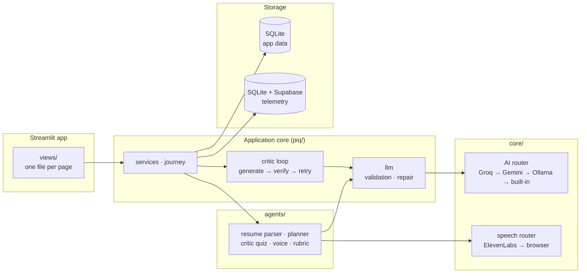

<div align="center">

<a href="https://github.com/prajwalparish-git/Skill-Scout-Nexus">
  <picture>
    <source media="(prefers-color-scheme: dark)" srcset=".github/assets/hero-dark.svg">
    
  </picture>
</a>

<p>
  <a href="https://github.com/prajwalparish-git/Skill-Scout-Nexus/actions/workflows/ci.yml"></a>
  
  
  
  
</p>

<p>
  <b>Profile a resume, close the skill gaps, practise under a critic's eye, and show the placement cell where the cohort stands.</b>
</p>

<p>
  <a href="#overview">Overview</a> ·
  <a href="#features">Features</a> ·
  <a href="#quick-start">Quick start</a> ·
  <a href="#configure-env">Configure .env</a> ·
  <a href="#running-locally">Running locally</a> ·
  <a href="#how-it-works">How it works</a>
</p>

</div>

---

## Overview

Skill Scout Nexus is a placement-readiness coach for students across Engineering, Commerce,
Law, Management, Healthcare and Government roles. A team of AI agents reads a student's
resume against the role they want, plans what to study, sets quizzes and runs spoken mock
interviews. A critic agent checks every generated question and plan before the student sees
it, and quiz results shape the next week's plan. Faculty get a cohort dashboard and a
placement-readiness report they can export.

It runs on a laptop with nothing but Python. With no API keys at all it works in mock mode,
so every page can be tried offline; add a free Groq or Gemini key for live AI.

## Features

**The six-step placement journey**

| Step | What the student gets |
|:---:|---|
| **1. Onboarding and profile** | A resume (PDF, DOCX or TXT) against a target role: readiness score, skills found and missing, resume fixes. |
| **2. Resume scan and skill gaps** | The resume read against any role in any stream: required skills named, the gaps, the degree and stream it shows. |
| **3. 7-day study roadmap** | A day-by-day plan for the gaps with objectives, free resources and micro-tasks to tick off, saved week by week. |
| **4. Critic-checked quiz** | Questions on one skill, each checked for sound facts, a single right answer and fair options; a verified question bank fills any gap. |
| **5. Proctored voice assessment** | A spoken scenario question, a spoken or typed answer, a 0-15 rubric score, and flags for terse, off-topic or buzzword answers. |
| **6. Faculty dashboard** | Readiness by stream, score distributions, rubric criteria, the most common skill gaps, the weekly trend, and **Export placement readiness report** (CSV). |

**More tools:** an adaptive weekly plan that follows quiz scores, a full quiz with its
step-by-step critic trail, a chat mock interview, an ATS resume builder with PDF export, a
project space for computing roles, and a personal dashboard.

**Built to keep working**

- **Self-healing AI.** Requests go to Groq first, then Google Gemini, then a local Ollama
  model, then built-in answers from the question bank. Several API keys can share the load
  in turn; a key that hits its rate limit rests while the next one answers.
- **Never blocks on the network.** Records are saved to a local SQLite database at once and
  copied to a cloud PostgreSQL (such as Supabase) in the background, catching up after an
  outage.
- **No key prompts, ever.** Keys are read from `.env`; anything missing is skipped quietly.
- **Accessible design.** Light and dark themes, readable on a phone and on a projector,
  self-hosted fonts so it works without internet.

## Quick start

You need **Python 3.13** and **Git**.

```bash
git clone https://github.com/prajwalparish-git/Skill-Scout-Nexus.git
cd Skill-Scout-Nexus
python -m venv .venv
```

Activate the environment and install the dependencies:

| Windows (PowerShell) | macOS / Linux |
|---|---|
| `.venv\Scripts\Activate.ps1` | `source .venv/bin/activate` |

```bash
pip install -r requirements.txt
```

Create your settings file from the template:

| Windows | macOS / Linux |
|---|---|
| `copy .env.example .env` | `cp .env.example .env` |

That is enough to run the app in mock mode. For live AI, fill in `.env` as below.

## Configure .env

Only **Groq and/or Gemini** are needed for cloud AI; everything else is optional and falls back
on its own.

1. Get a free key from [Groq](https://console.groq.com/keys) or [Google AI Studio](https://aistudio.google.com/apikey) (or both).
2. Put it in `.env` and turn off mock mode:

```ini
MOCK_MODE=false
GROQ_API_KEYS=gsk_your_key            # several keys: gsk_key1,gsk_key2,gsk_key3
GEMINI_API_KEYS=AIza_your_key         # optional second provider, also comma-separated
```

| Key | What it does | If left blank |
|---|---|---|
| `GROQ_API_KEYS` | The fastest cloud AI, and speech-to-text for spoken answers | Skipped |
| `GEMINI_API_KEYS` | A second cloud AI | Skipped |
| `OLLAMA_BASE_URL`, `OLLAMA_MODEL` | A local model that works without internet ([ollama.com](https://ollama.com), then `ollama pull llama3.2:3b`) | Skipped |
| `ELEVENLABS_API_KEY` | A natural voice for interview questions | The browser reads them aloud |
| `SUPABASE_DB_URL` | A cloud copy of all records, for faculty across several machines | Records stay on this machine |

The model names in `.env.example` are current; every option is explained in that file. Never
commit `.env`.

## Running locally

```bash
streamlit run app.py
```

Then open **http://localhost:8501**.

To explore with sample data first:

```bash
python -m scripts.seed           # a demo student with four weeks of history
python -m scripts.seed_cohort    # a fictional cohort for the faculty dashboard
```

Choose **DEMO0001** under **Student** in the sidebar to see a returning student.

<details>
<summary><b>Optional: the Next.js front end</b></summary>

<br>

A faster web front end over the same services, with instant quizzes from the question bank:

```bash
uvicorn server:app --port 8000             # the API, reading the same .env
cd frontend
npm install
npm run dev                                # http://localhost:3000
```

Set `NEXT_PUBLIC_API_URL=http://localhost:8000` in `frontend/.env.local`.

</details>

<details>
<summary><b>Optional: check your Groq models before a demo</b></summary>

<br>

```bash
python -m scripts.check_models
```

It confirms the configured models are still served, answer in JSON and have quota left.

</details>

## How it works

<div align="center">
  <picture>
    <source media="(prefers-color-scheme: dark)" srcset=".github/assets/layer3-dark.svg">
    
  </picture>
</div>



| Layer | Built with |
|---|---|
| Interface | Streamlit 1.66 with Altair charts; optional Next.js 14 over FastAPI |
| Agents | LangGraph generate → verify → retry loop; every AI answer is a validated Pydantic model |
| AI | Groq and Google Gemini (round-robin key pools), local Ollama, built-in answers |
| Voice | ElevenLabs or the browser's Web Speech API; Whisper on Groq for transcription |
| Storage | SQLite for the app; telemetry on local SQLite with a background copy to Supabase PostgreSQL |

<div align="center">
<br>
<sub>Built with Streamlit, LangGraph and Pydantic · runs offline in mock mode · <a href="https://github.com/prajwalparish-git/Skill-Scout-Nexus">github.com/prajwalparish-git/Skill-Scout-Nexus</a></sub>
</div>
