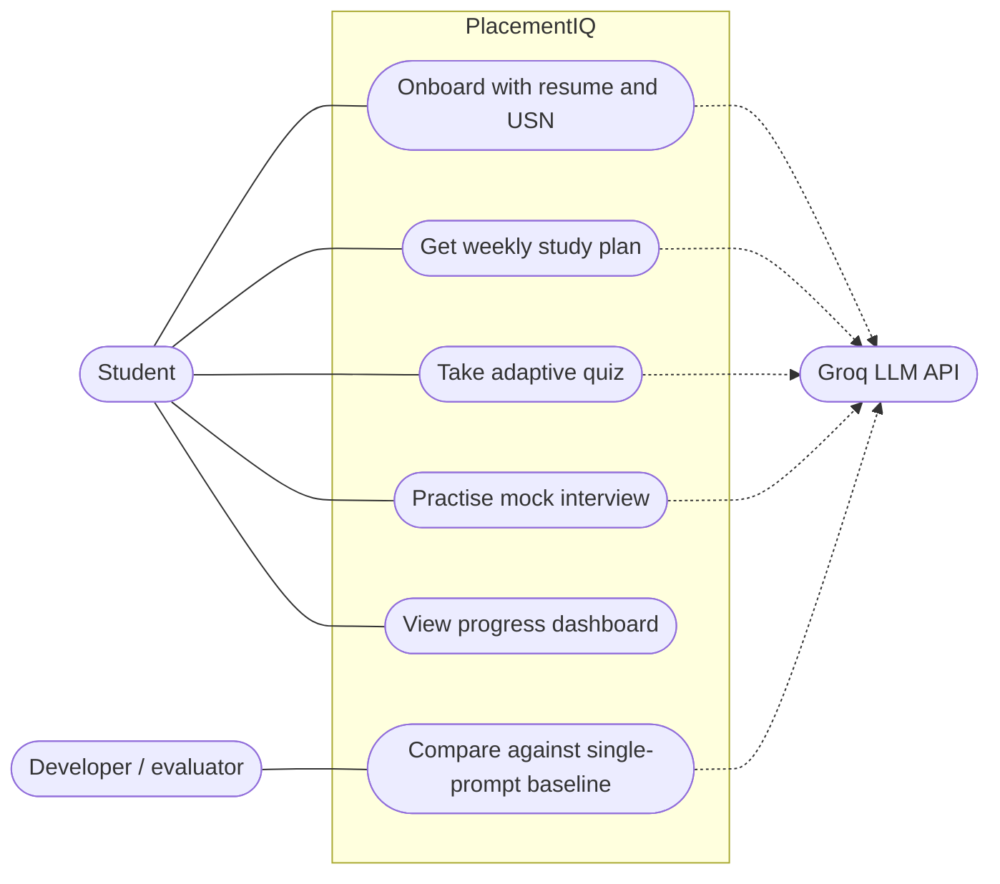
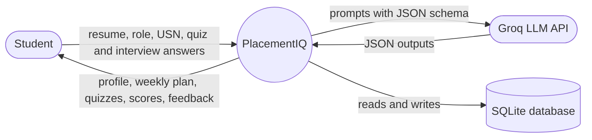
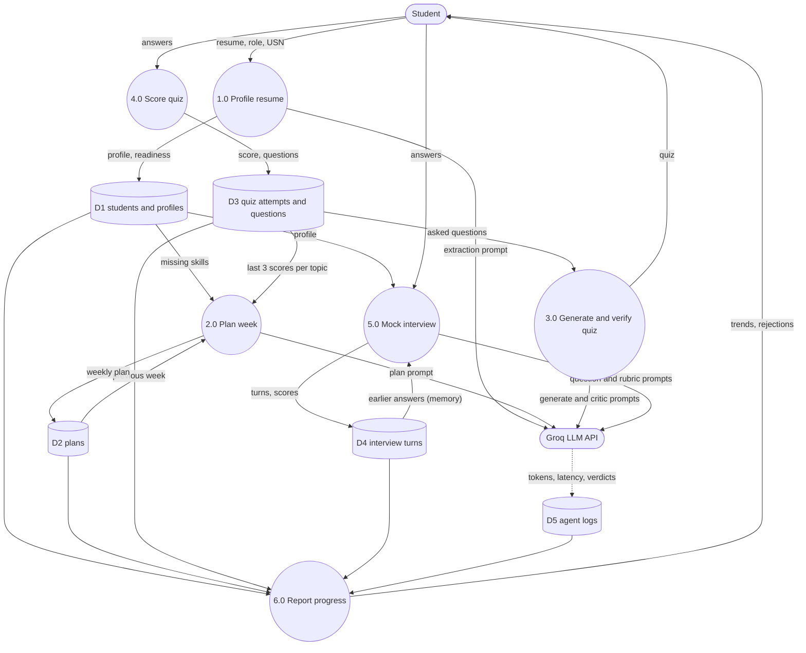
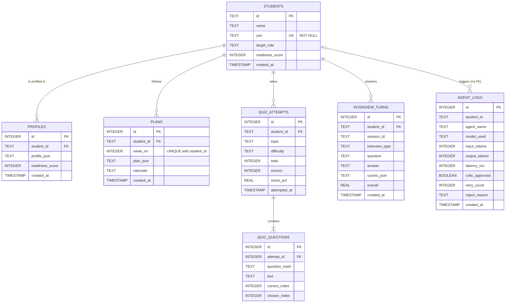

# Diagrams

Report diagrams for PlacementIQ, drawn from the code as built. GitHub renders the Mermaid
blocks below; to put one in the report, paste it into a Mermaid editor and export it as PNG or SVG.
The LangGraph critic loop is generated from the real compiled graph: see
[critic_graph.md](critic_graph.md) (`python -m scripts.export_graph`).

## Use cases


## Components
```mermaid
flowchart TB
    views[Streamlit views] --> services[services: controllers]
    views --> formatter[formatter: output layer]
    views --> ui[ui: student selector, visible agent loop]
    services --> agents[agents]
    services --> db[(SQLite via db.py)]
    agents --> checks[checks: deterministic rules]
    agents --> graph[graph: generate, verify, retry]
    graph --> llm[llm gateway]
    llm --> groq([Groq API])
    llm -.->|MOCK_MODE| mock([mock responses])
    llm --> db
```

## Data flow, level 0 (context)


## Data flow, level 1


## Entity relationships


## Sequence: resume → plan → quiz → re-plan
```mermaid
sequenceDiagram
    actor S as Student
    participant V as Streamlit views
    participant SV as services
    participant AG as agents + critic graph
    participant L as Groq LLM
    participant DB as SQLite

    S->>V: Resume, target role, USN
    V->>SV: onboard()
    SV->>AG: create_profile()
    AG->>L: Extract skills (small model)
    L-->>AG: ProfileExtraction JSON
    AG->>AG: Matched skills must be in the role list; readiness computed in code
    SV->>DB: Save student and profile

    S->>V: Generate week 1
    V->>SV: generate_next_plan()
    SV->>DB: Read quiz scores
    loop Until approved (max 3 attempts)
        AG->>L: Plan (large model)
        AG->>AG: Week, days, weak share ≥ 50%, minutes ordered by weakness
    end
    SV->>DB: Save plan

    S->>V: Generate OS quiz
    V->>SV: start_quiz()
    loop Until approved (max 3 attempts)
        AG->>L: Generate questions
        AG->>AG: Deterministic checks (count, options, duplicates)
        AG->>L: Critic judges questions not yet judged
        Note over AG,L: A retry replaces only the rejected questions
    end
    S->>V: Submit answers (low score)
    V->>SV: submit_quiz()
    SV->>DB: Save attempt and questions

    S->>V: Generate week 2
    V->>SV: generate_next_plan()
    SV->>DB: Read new scores and last week
    AG->>L: Plan with new weakness
    Note over AG: The weakest topic must now get the most minutes
    SV->>DB: Save week 2
    V-->>S: Week 1 vs week 2 chart
```
